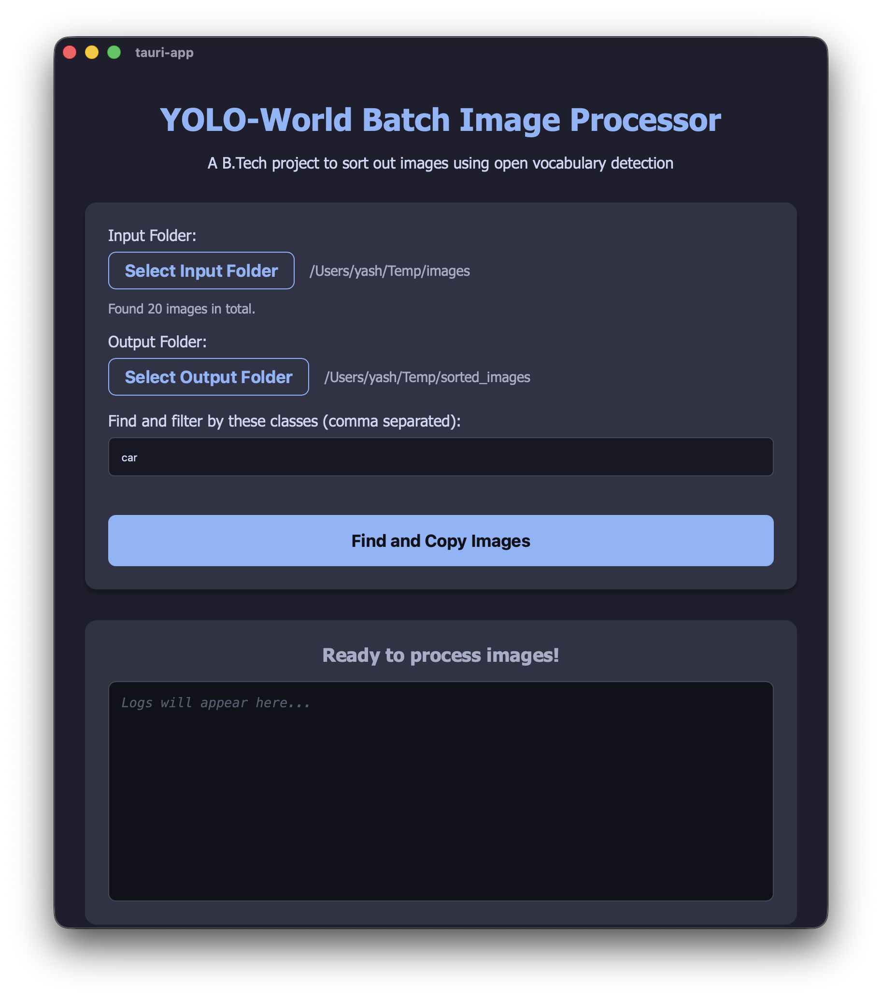
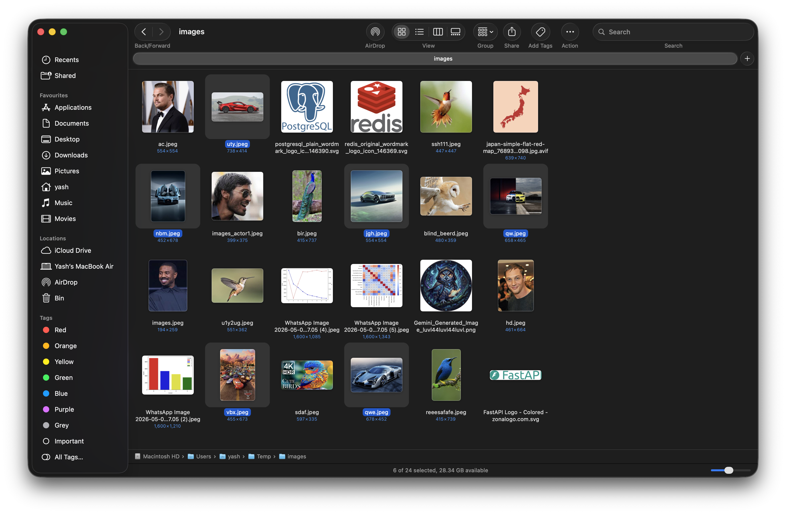
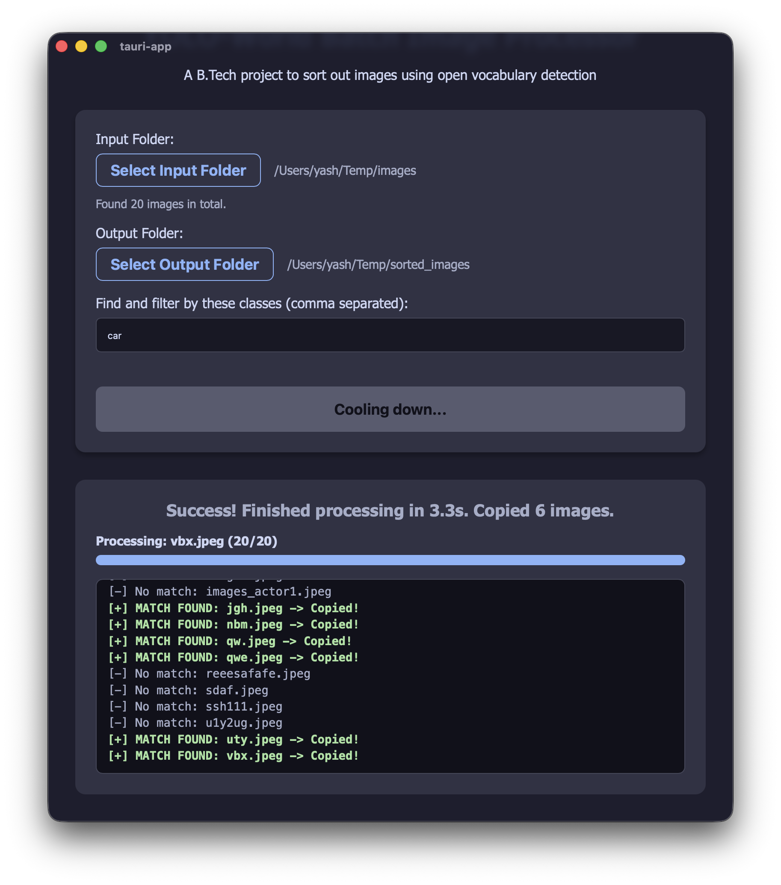
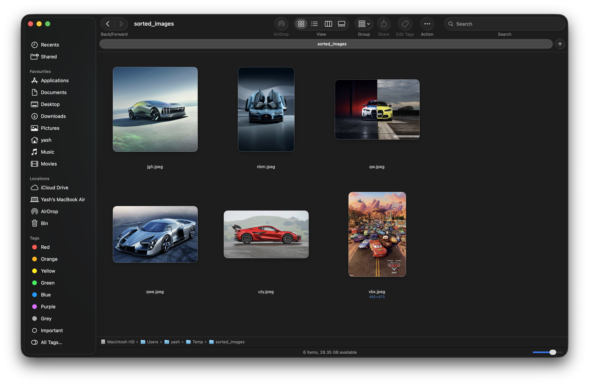

# YOLO World Image Sorting Project

This is my project for image sorting using yolo world open vocabulary model. The basic idea is that we have a lot of images in a folder and we only want to find some specific things like "car" from them. Doing this by hand takes a lot of time and effort. So I made this desktop app using Tauri and React for the frontend and the backend is using FastAPI in python.

## How it works

The user selects a input folder which has all the mixed images. Then they select a output folder where they want the filtered images to go. Then you can type what you want to find in the text box. Like if you type "car", the python model will check every image and if there is a car it will copy it to the output folder. It also checks if the output folder is empty or not and prevents duplicate copying.

Here is how the app looks when you open it:


## Example implementation

For testing the project, I used a input folder which had many mixed images, but there are exactly 6 images of cars in it.
Here is the input folder containing all the mixed images:


I put "car" in the custom classes box and clicked process. The app started checking all the images one by one. When the process finished, it successfully found all 6 car images. This is the completion screen showing the logs and that it copied exactly 6 images:


And here is the output folder where you can see all 6 car images are safely sorted and copied there by the python backend without overwritng anything.


## Setup instructions

To run this on your local system you need to run both front end and back end:

**1. Start the python backend**
Make a virtual env and install requirements:
```bash
cd backend
python3 -m venv venv
source venv/bin/activate
pip install -r requirements.txt
python main.py
```
*(It will download the small yolo model weight file if running first time).*

**2. Start the frontend app**
Open a new terminal and run:
```bash
cd frontend
pnpm install
pnpm tauri dev
```
The app desktop window will open automatically.
